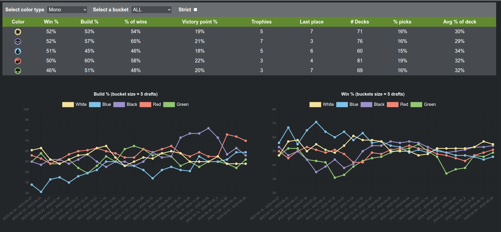

# cube-tools



This repository is meant to help parse, track, and analyze **Magic: The Gathering** draft results.

You can find [my cube on Cube Cobra](https://cubecobra.com/cube/overview/polyversal)

There are a few parts to this repository:

- A Golang binary that parses various deck input formats, merges them with other metadata, and stores them for posterity.
- A very basic React site to run locally for viewing statistics compiled from the parsed deck and draft data.
- JSON formatted draft logs from applicable drafts (i.e., those done with draftmancer)
- Historical cube snapshots taken at the time of each draft.
- Replay files from Cockatrice (where applicable).

Data for each draft can be found in [data](data). Structure is as follows:

```
data/                        # data root directory, with a sub-directory per-cube.
|-- <cube-name>/             # cube directory
   |-- index.json            # auto-generated index file of decks.
   |-- NNNN_YYYY-MM-DD/      # draft directory, named for the draft's number and date.
      |-- metadata.json      # draft number, date, event name, code, and flight.
      |-- N.json             # deck file for the draft's deck number N.
      |-- cube-snapshot.json # snapshot of the cube at this date.
      |-- draft-log.json     # optional draft log from Draftmancer.com
      |-- replays/           # optional cockatrice replays directory.
```

The above file structure is largely generated using the Go tool provided.

## Building the go tool

Build all tools with `make`.

Help text can be retrieved with `./bin/parser -h`:

```
Parse and manage cube-tools data files.

Usage:
  Parse [command]

Available Commands:
  completion      Generate the autocompletion script for the specified shell
  edit            Edit an existing deck file
  help            Help about any command
  index           Regenerate index files for the drafts directory.
  parse           Parse a single deck file
  parse-dir       Parse a directory of deck files
  parse-draft-log Parse a draft log
  reparse         Reparse existing data files to update them

Flags:
  -h, --help   help for Parse

Use "Parse [command] --help" for more information about a command.
```

## Scanning cards

I typically use an Android app called "Delver Lens" to scan each decklist after a draft, and generate `.csv` files which can be used as input to this tool.

You can also use the "Download all decks" feature of [Draftmancer](https://draftmancer.com/) to get `.txt` files, if you draft there.

## Players

Every deck belongs to a player from the global list in `data/players.json`, or is an anonymous seat (`p1`, `p2`, ...) until you assign one. Add a player before parsing their decks:

```
./bin/parser players add "Joe Strummer"
./bin/parser players list                       # id<TAB>name
./bin/parser players rename "Joe Strummer" "Joe Mellor"
./bin/parser players assign --cube polyverse --draft 15 --deck 3 "Joe Mellor"   # or: anonymous
```

Commands that take a player (`parse --who`, `edit add-match -p/-o`) accept a player's number or name, ignoring case, and fail on a name that isn't in the list. `parse-dir` and `parse-draft-log` map file names and draft-log usernames to players the same way, through a small nickname table. Pass `--anonymous` to make every deck a seat instead. The browser can do all of this too: the Players page renames, and the deck record editor and import screens pick or add players.

## Adding draft information

Once you have downloaded / created deck files within a directory, use can parse them like so:

```
./bin/parser parse-dir --cube polyverse \
    --deck-dir ~/Downloads/draft/ \    # Path to deck files.
    --date 2024-01-07 \                # Date of the new draft.
    --event-code local \               # Short event code, searchable with event:.
    -p Prefix \                        # Optional prefix to match for each deck file.
    --filetype ".txt"                  # Filetype to check.
```

This creates a new numbered draft and logs its number. Pass `--draft <number>` instead of `--date` to add decks to an existing draft.

This will also run a consistency check to ensure decks have the correct number of cards, and that the drafted card list matches the expected cube contents (i.e., check for missing or extra cards).

Optional next steps:

- Add replays to `replays/`
- Add a `draft-log.json`
- Update parsed deck files with labels.

You can then add match information. e.g., the following adds a match that Joe won 2-1 against the anonymous seat p2. `-p` and `-o` take a player's number or name, or a seat label.

```
./bin/parser edit add-match --cube polyverse --draft 15 -p "Joe Mellor" -o p2 -r "2-1-0"
```

Finally, index the new draft information so it can be discovered by the UI:

```
./bin/parser index
```

## Updating metadata

To run a full regeneration of the draft data (e.g., to pull in updated oracle text and other metadata):

```
make reparse
```

## Adding draft logs

Each draft can optionally include a log exported from draftmancer including draft pick ordering. This is included in the UI.

Draft logs are found at `data/<cube>/NNNN_YYYY-MM-DD/draft-log.json`, and are added with `./bin/parser parse-draft-log --cube <cube> --draft <number> -f <log file>`.

## Running the UI

If you haven't already, install node dependencies:

```
cd ui
npm install
```

Then, you can start the UI by running the following:

```
make run
```

## Cockatrice replays

Cockatrice replay files are stored in `data/polyverse/NNNN_YYYY-MM-DD/replays/`
